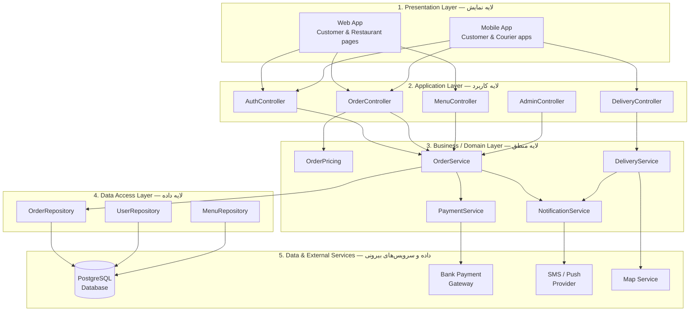

# Meeting 5 — Software Architecture and Component Design
# (معماری نرم‌افزار و طراحی لایه‌ای)

- **Course:** Software Engineering (مهندسی نرم‌افزار) — Pressman, Chapters 10–11
- **Student:** Farzad Taherzadeh
- **Teacher:** Rasoulzadeh
- **Project:** Online Food Ordering System — "FoodExpress" (سیستم سفارش آنلاین غذا)

Same system as Meetings 1–4. This file defines the architecture:
the layers, the components inside them, and the interfaces between them.

---

## 1. Architectural Style — Layered Architecture (معماری لایه‌ای)

**Choice:** Layered architecture (n-tier), as a single deployable
application (monolith) first. It is the simplest style that fits this
project: a small team, one database, and clear layers. If the system
grows, one layer (for example, the Delivery service) can later be
split out into its own service without rewriting the rest.

**Rules of the layers:**

1. A layer only calls the layer directly **below** it.
2. A layer never skips a layer (the UI never talks to the database).
3. Each layer has one job: show, control, decide, or store.

---

## 2. Layered Architecture Diagram (نمودار معماری لایه‌ای)



---

## 3. Components and Their Interfaces (کامپوننت‌ها و اینترفیس‌ها)

An interface is a contract: what a component offers, and what it needs.
Other components use only the interface, never the inside of a component.

| Component | Layer | Provides (interface) | Needs (from others) |
| --- | --- | --- | --- |
| **AuthController** | Application | `login(phone, password) → token` · `register(user) → userId` | `UserRepository.findByPhone()` |
| **OrderController** | Application | `createOrder(cart, address) → orderNumber` · `getOrderStatus(orderId) → status` | `OrderService.placeOrder()`, `OrderPricing.calculateTotal()` |
| **MenuController** | Application | `listRestaurants() → restaurants` · `getMenu(restaurantId) → items` · `searchFood(text) → items` | `MenuRepository` |
| **DeliveryController** | Application | `getCourierLocation(orderId) → position` · `confirmDelivery(orderId)` | `DeliveryService` |
| **OrderService** | Business | `placeOrder()` · `acceptOrder()` · `rejectOrder()` · `updateStatus()` | `PaymentService.pay()`, `NotificationService.send()`, `OrderRepository` |
| **OrderPricing** | Business | `calculateTotal(items, deliveryFee) → total` | nothing (pure calculation) |
| **PaymentService** | Business | `pay(amount) → success/failed` · `refund(paymentId)` | `IPaymentGateway` (bank gateway) |
| **DeliveryService** | Business | `assignCourier(order) → courier` · `track(orderId) → position` | `Map Service`, `NotificationService` |
| **NotificationService** | Business | `send(user, message)` | SMS / Push provider |
| **OrderRepository** | Data | `save(order)` · `findById(id)` · `findByCustomer(id)` · `findByStatus(status)` | PostgreSQL database |
| **UserRepository** | Data | `save(user)` · `findByPhone(phone)` | PostgreSQL database |
| **MenuRepository** | Data | `save(item)` · `findByRestaurant(id)` | PostgreSQL database |

### Interface example — Payment (the most important one)

```text
interface IPaymentGateway {
    pay(amount, cardToken) -> { success: true/false, receiptId }
    refund(receiptId)      -> { success: true/false }
}
```

The OrderService calls only this interface. The real class behind it
can be any bank gateway. Changing the bank means writing one new
class that follows this interface — nothing else in the system changes.
This is the low coupling from Meeting 4, made concrete.

---

## 4. Why This Architecture Fits (چرا این معماری؟)

| Quality (from Meeting 2, NFRs) | How the architecture gives it |
| --- | --- |
| **Performance** (menu < 3 s, NFR-01) | The Data layer uses one indexed query per list; the Presentation layer caches the menu for 5 minutes. |
| **Availability 99%** (NFR-02) | Layers are separate: a crash in the map service cannot stop ordering, because Delivery is only called after the order exists. |
| **Security** (NFR-03) | Only the Data layer touches the database; passwords are hashed in the Business layer; card numbers never enter our database — only the gateway sees them. |
| **Scalability** (1,000 users, NFR-05) | The stateless Application layer can run on two servers behind a load balancer; the database is the only shared part. |
| **Change** | A new feature (for example, a discount code) changes only the Business layer (`OrderPricing`) — the UI and the database stay the same. |

---

## 5. Deployment — First Version (استقرار نسخه اول)

- **One server** runs the whole application (layers 1–4 in one process).
- **PostgreSQL** runs on the same server or a small second server.
- **External services:** bank payment gateway, SMS provider, map service.
- **Later, if needed:** the Delivery Service can move to its own server,
  and the database can be replicated. The layer boundaries make that
  possible without rewriting the application.
