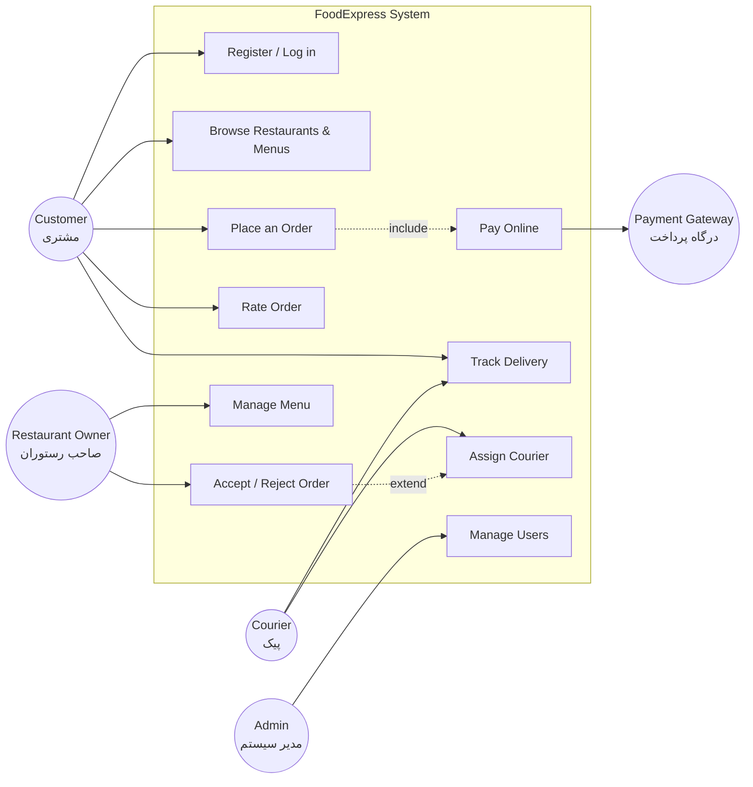
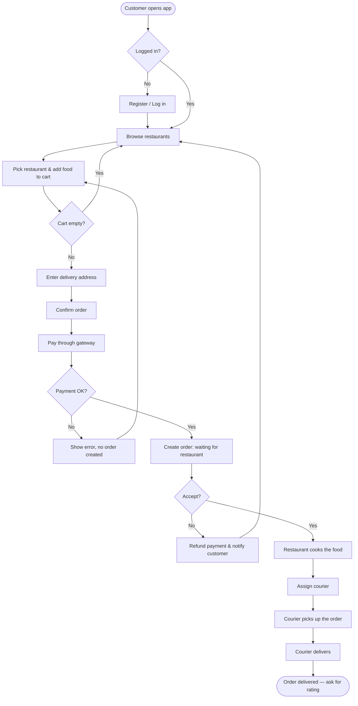
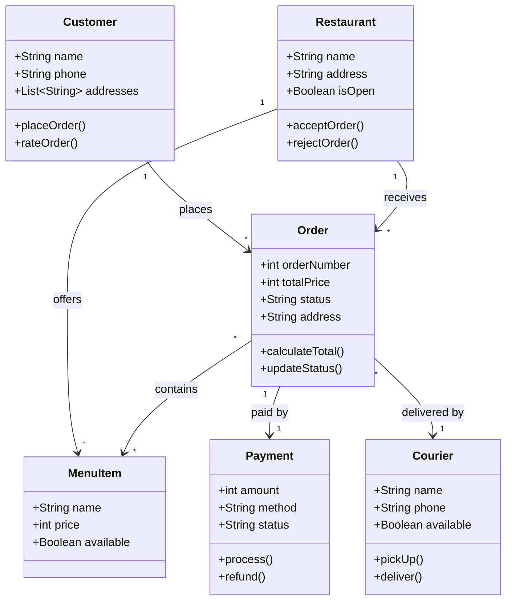
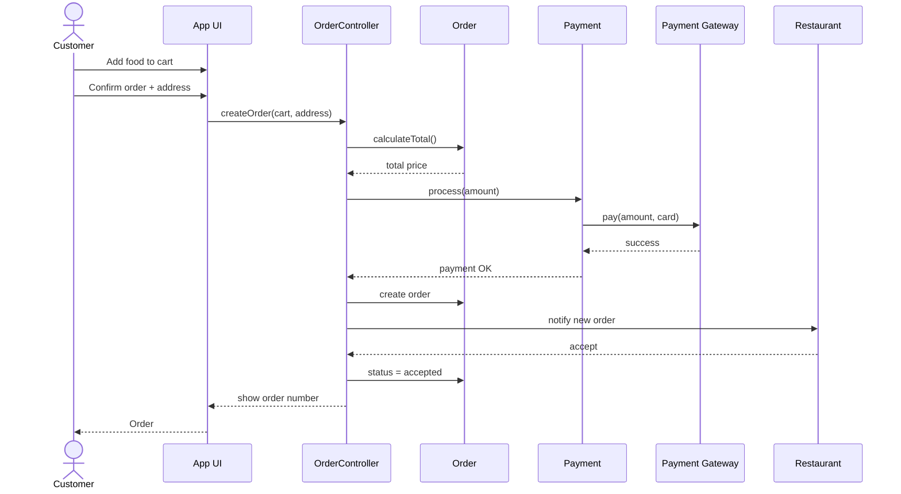

# Meeting 3 — Requirements Modeling and UML (مدلسازی نیازمندی‌ها و UML)

- **Course:** Software Engineering (مهندسی نرم‌افزار) — Pressman, Chapter 8
- **Student:** Farzad Taherzadeh
- **Teacher:** Rasoulzadeh
- **Project:** Online Food Ordering System — "FoodExpress" (سیستم سفارش آنلاین غذا)

Same system as Meetings 1–2. This file models the requirements from
`REQUIREMENTS.md` with UML diagrams. All diagrams are Mermaid code,
so they render directly on GitHub.

---

## 1. Use Case Diagram (نمودار یوزکیس)

Actors: Customer, Restaurant Owner, Courier, Admin. The Payment Gateway
is an external system actor.

Notes on the relations:
- **Include:** "Place an Order" always includes "Pay Online" — no order
  without payment.
- **Extend:** "Assign Courier" extends "Accept / Reject Order" — it only
  happens after the restaurant accepts.

---

## 2. Text Scenario — Key Use Case: Place an Order (سناریوی متنی)

**Use case:** UC-03 Place an Order. **Actor:** Customer.

1. The customer logs in and sees the restaurant list.
2. The customer picks a restaurant and the menu opens.
3. The customer adds two foods to the cart (for example, one pizza
   and one drink). The cart shows the total price.
4. The customer opens the cart, checks the total (for example,
   450,000 Toman), and enters the delivery address.
5. The customer taps "Confirm and Pay".
6. The system sends the customer to the bank payment gateway.
7. The customer pays. The gateway returns "success".
8. The system creates order #1042 with status "waiting for restaurant"
   and shows the order number to the customer.
9. The restaurant owner sees the order and taps "Accept".
10. The order status becomes "accepted" and the kitchen starts cooking.

If payment fails at step 7, no order is created and the customer
returns to the cart. If the restaurant rejects at step 9, the payment
is refunded automatically.

---

## 3. Activity Diagram — Main Process: Order Food (نمودار فعالیت)

The main process, from opening the app to food delivered.

---

## 4. Main Classes (کلاس‌های اصلی)

Four main classes, taken from the use cases (nouns in the scenarios
become classes).

| Class | What it holds / does |
| --- | --- |
| **Customer** | name, phone, address list; places orders, rates orders |
| **Restaurant** | name, address, open/closed; owns menu items; accepts orders |
| **MenuItem** | name, price, photo, available or not; belongs to a restaurant |
| **Order** | order number, items, total price, status, address; the central class of the system |
| **Payment** | amount, method, status (paid / failed / refunded) |
| **Courier** | name, phone, vehicle, available or not; delivers orders |

### CRC Card — Control Class: OrderController (کارت CRC)

The control class coordinates the "Place an Order" use case. It does
not store data itself — it tells the other classes what to do.

| OrderController | |
| --- | --- |
| **Responsibilities** | **Collaborators** |
| Check that the cart is not empty | Cart, Customer |
| Calculate the total price (items + delivery fee) | Order, MenuItem |
| Call the payment gateway and read the result | Payment, Payment Gateway |
| Create the Order and set its first status | Order |
| Notify the restaurant about the new order | Restaurant, NotificationService |
| Assign a courier when the order is ready | Courier |

---

## 5. Class Diagram (نمودار کلاس)

Relations: a Customer places many Orders (1 to *); an Order contains
many MenuItems; one Order has one Payment; one Courier delivers many Orders.

---

## 6. Sequence Diagram — Place an Order (نمودار توالی)

The same main process, shown as messages between objects over time.

